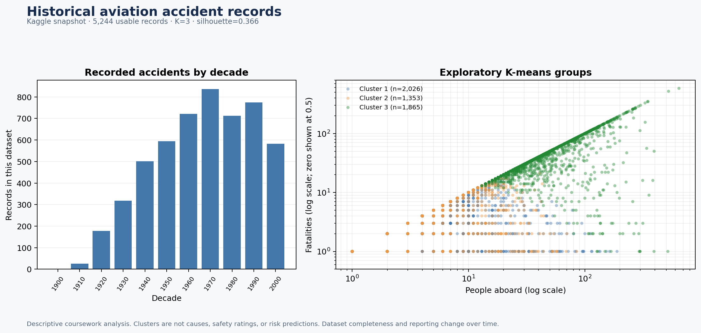

# Aviation Accident Clustering

A coursework project exploring historical aviation accident records with descriptive clustering. It preserves the original class analyses and adds a reproducible workflow for the Kaggle dataset copy used here.

## Preview

This point-in-time Kaggle download had 5,268 source rows. Of these, 5,244 passed the analysis filters for a valid date, positive aboard count, and nonnegative fatality count. The silhouette score is a clustering diagnostic, not evidence that the groups are meaningful accident types.

## Analyses

- `Assignment4.py`: original numeric-feature K-means coursework script. It expects the historical CSV and an `AC Type` column.
- `final_explore.py`: original rule-based text feature and K-means exploration. Keyword matches are not verified causes.
- `aviation_analysis.py`: command-line workflow for the Kaggle format. It uses year and log-transformed aboard/fatality counts, standardizes the features, fits K-means, and exports a cluster summary and charts.

## Data source and versions

The source associated with this project is Kaggle's [Airplane Crashes Since 1908](https://www.kaggle.com/datasets/saurograndi/airplane-crashes-since-1908), titled *Airplane Crashes and Fatalities Since 1908*. The Kaggle page describes a historical collection that originated from a Socrata-hosted source. Review the provider's current terms before redistributing any copy.

The repository's coursework CSVs are older snapshots. The downloaded Kaggle copy has a `Type` column, while the original numeric script expects `AC Type`. Their schemas differ and record-level equivalence has not been established. The new `aviation_analysis.py` workflow only needs `Date`, `Aboard`, and `Fatalities`, so it can read the Kaggle copy without renaming `Type`.

## Reproduce the Kaggle workflow

Install Python 3.10 or newer. Create and activate an environment, then install dependencies:

~~~bash
python -m venv .venv
# macOS / Linux
source .venv/bin/activate
# Windows PowerShell
.venv\Scripts\Activate.ps1
python -m pip install -r requirements.txt
~~~

Download the CSV from the Kaggle page and run:

~~~bash
python aviation_analysis.py --input path/to/Airplane_Crashes_and_Fatalities_Since_1908.csv --output-dir outputs --clusters 3
~~~

The script also accepts the downloaded ZIP when it contains one CSV. It writes `cluster_summary.csv`, `aviation_accident_patterns.png`, and `aviation_accident_patterns.svg` into the output directory. The root-level PNG above is the preview generated from the supplied snapshot.

## Limitations

- The clusters depend on selected features, log transforms, scaling, and the chosen cluster count. Cluster numbers are labels, not rankings.
- Accident counts over time reflect dataset coverage and reporting as well as events; they are not exposure-adjusted accident rates.
- Missing or inconsistent records affect which rows are included. The script drops rows missing date, aboard, or fatalities and excludes nonpositive aboard counts and negative fatalities.
- Narrative keyword categories can overlap, miss context, and encode assumptions. They should not be interpreted as ground-truth causes.
- These exploratory analyses do not establish causation, predict future risk, or support operational safety decisions.
